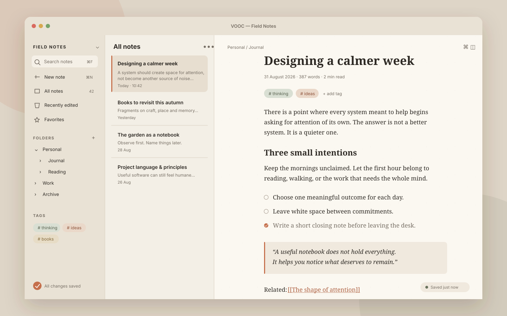
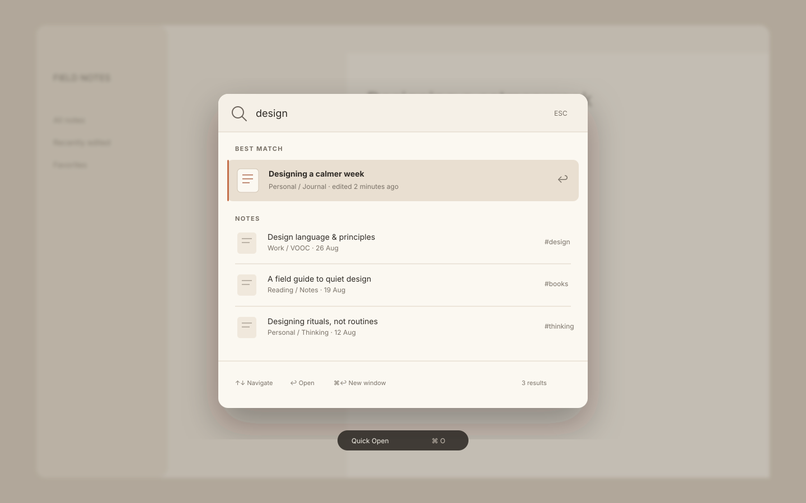
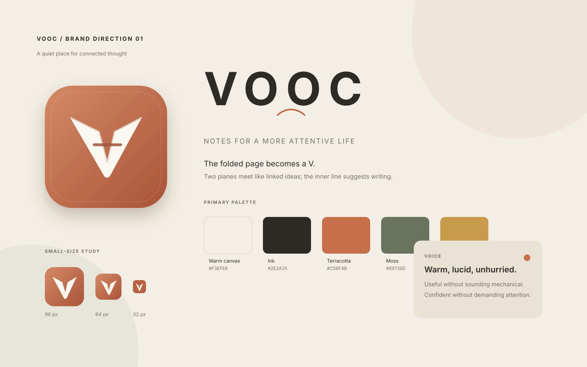

# my-software

**A personal software lab for building and learning from small, independent apps.**

## Featured design · VOOC for macOS

A calm, local-first Markdown notebook concept built around native macOS interactions, keyboard-first navigation, and a warm, paper-like interface.

> **Concept previews:** The images below illustrate the proposed VOOC design. They are **not screenshots of the current Swift/AppKit prototype**.

### Main window

A three-column workspace for vault navigation, note discovery, and focused writing.



| Quick open | Brand direction |
| :---: | :---: |
|  |  |
| Keyboard-first search across a local vault | Folded-paper mark, icon, and color palette |

[Explore VOOC design previews](./vooc/design/README.md) · [Read the design specification](./vooc/design/design-spec.md) · [Run the macOS prototype](./vooc/macos/README.md)

## Projects

| Project | Description | Status |
| --- | --- | --- |
| [Personal Workbench](./personal-workbench/README.md) | A single-user web app for Markdown notes, tasks, and day planning. | V0 implemented; deployment and backup limits are documented. |
| [Memento](./memento/README.md) | An offline-first iPhone and iPad notes app built around portable Markdown. | In development; Apple-platform build and device acceptance remain unverified. |
| [VOOC for macOS](./vooc/macos/README.md) | A native prototype for editing Markdown files in a folder you choose. | Prototype; see its README for current scope. |
| [VOOC design previews](./vooc/design/README.md) | Concept art and interface direction for VOOC. | Design material, not screenshots of the running app. |
| [Today Workspace](https://github.com/chivopic/today-workspace) | A mobile-first workspace for quick capture and tasks. | Maintained in its own repository. |

## Development

Each project has its own toolchain. Start with its README for setup and requirements. From the repository root, the main checks are:

```bash
cd personal-workbench && pnpm install --frozen-lockfile && pnpm typecheck && pnpm lint && pnpm test && pnpm build
cd ../memento && python3 scripts/generate-project.py --check && bash scripts/test-core.sh
cd ../vooc/macos && swift test
```

Personal Workbench requires Node.js 20.9 or later, pnpm 10.33.0, and Docker Compose for its local PostgreSQL database. Memento simulator builds require macOS with Xcode 16 or later; its portable core tests can run with Swift 6 or later. VOOC requires macOS 14 or later and Swift 6 or later. Platform-specific checks are described in each project README.

## Versions and contributions

Projects use independent version numbers and tags. The existing unscoped `v0.1.0` tag belongs to Personal Workbench; future tags should include the project name. See [release and versioning policy](./docs/releasing.md) and [contribution guide](./CONTRIBUTING.md).

No license has been selected. Until the repository owner chooses one, the repository does not grant general permission to reuse, modify, or redistribute its code. See [LICENSE status and options](./docs/releasing.md#license-decision).

## Repository structure

Projects keep their own source, dependencies, documentation, and CI. Today Workspace moved to [its own repository](https://github.com/chivopic/today-workspace) on 2026-09-06; this repository retains its earlier history.
